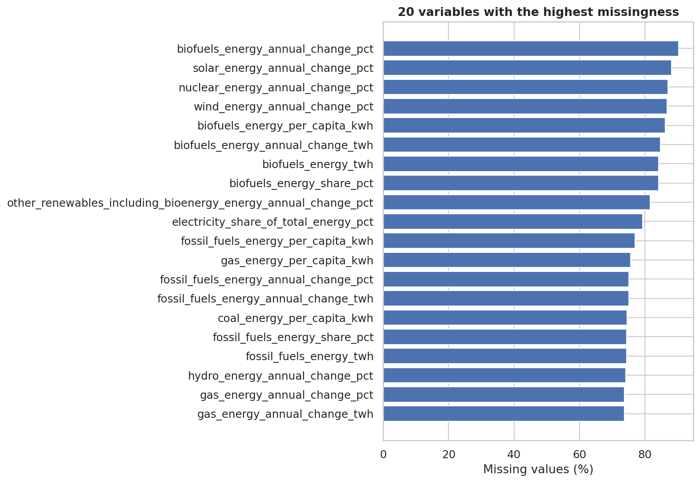
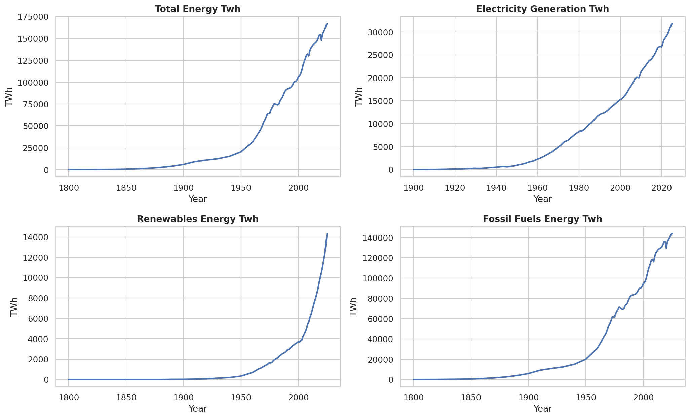
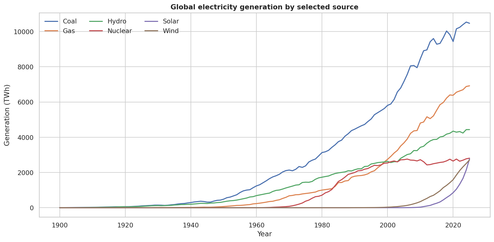
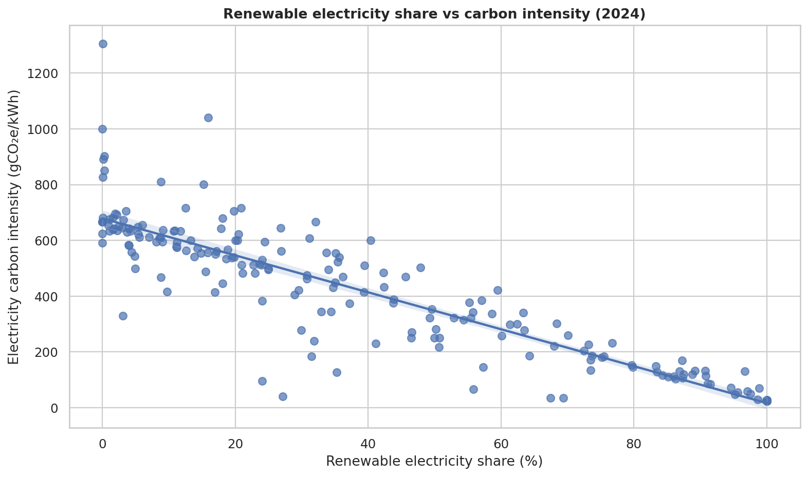

# Global Energy Intelligence
### Exploring the relationship between energy systems, renewable electricity and carbon intensity

**An end-to-end data analytics portfolio project by [Sahil Singh](https://github.com/Sahil-Singh01).**

I explored global energy consumption, electricity generation, energy-source composition and country-level differences using the Our World in Data (OWID) Energy dataset. The analysis moves from data-quality assessment to descriptive exploration, global trends, country benchmarking and statistical investigation.

The focus is not just on producing charts. It is on asking clear questions, making defensible analytical choices, interpreting results in plain language and communicating what the data can — and cannot — tell us.

---

## Project snapshot

| | |
|---|---:|
| Dataset | OWID Energy |
| Records | **19,494** |
| Variables | **130** |
| Entity labels | **260** |
| Recorded years | **1700–2025** |
| Missing cells | **61.17%** |
| Duplicate entity–year keys | **0** |
| Analytical notebooks | **5** |

**Tools:** Python · Pandas · NumPy · Matplotlib · Seaborn · SciPy · Jupyter Notebook

## The questions I investigated

- How have global energy consumption and electricity generation evolved over time?
- How has the electricity mix shifted across coal, gas, hydro, nuclear, solar and wind?
- How do energy use, per-capita consumption, renewable electricity share and carbon intensity differ across country candidates?
- Is renewable electricity share associated with electricity carbon intensity?
- How should missingness, uneven reporting coverage and extreme values influence the conclusions?

## Selected findings

### 1. Data coverage is a central part of the analysis

The dataset contains **61.17% missing cells** overall. Rather than treating missing values as zero or dropping every incomplete row, I used indicator-specific samples and checked coverage before drawing comparisons. This matters because the available countries and years can differ substantially from one metric to another.

### 2. Global energy and electricity trends need to be read separately

Total energy consumption and electricity generation measure different parts of the energy system. I analyzed the global World aggregate for time-series questions and kept aggregate records out of country-level comparisons to avoid double counting.

### 3. The global electricity mix has multiple moving parts

The source-level analysis compares electricity generation in TWh across major generation technologies. It distinguishes absolute generation from percentage share, since growth in total generation can change both measures differently.

### 4. Renewable electricity share is strongly associated with lower electricity carbon intensity in the 2024 sample

For the 2024 cross-section, the complete-case sample contains **195 country-candidate observations**.

| Statistical measure | Result |
|---|---:|
| Pearson correlation (r) | **−0.877** |
| Spearman rank correlation (ρ) | **−0.894** |
| Pearson p-value | **2.45 × 10⁻⁶³** |
| Bootstrap 95% confidence interval for Pearson r | **[−0.917, −0.836]** |

Both correlation measures indicate a strong negative association in this sample. This is an observational, cross-sectional result — **not evidence that renewable share alone causes lower carbon intensity**. Nuclear generation, fossil-fuel mix, imports, geography and other factors may also influence the relationship.

[Read the statistical findings](reports/statistical_findings.md) for the study design, sample definition and robustness notes.

---

## Analytical workflow

| Stage | What I worked on | What it demonstrates |
|---|---|---|
| 01 · Data audit | Schema review, integrity checks, missingness, entity and year coverage, quality flags | Data quality assessment and analytical judgement |
| 02 · Descriptive analysis | Summary statistics, distributions, skewness and coverage | Exploratory analysis and statistical reasoning |
| 03 · Global trends | World energy and electricity trends, generation mix, endpoint changes and growth | Time-series analysis and data storytelling |
| 04 · Country benchmarking | Indicator coverage, country-candidate comparisons and multi-year averages | KPI interpretation and fair comparisons |
| 05 · Statistical analysis | Pearson and Spearman correlation, bootstrap interval and sensitivity checks | Statistical testing and cautious interpretation |

## Explore the analysis

The notebooks are presented as a guided analytical narrative. Each one includes the question being investigated, the approach, relevant outputs and plain-English conclusions.

1. [Data Audit and Preparation](notebooks/01_data_audit_and_preparation.ipynb)
2. [Descriptive and Distributional Analysis](notebooks/02_descriptive_and_distributional_analysis.ipynb)
3. [Global Energy Trends](notebooks/03_global_energy_trends.ipynb)
4. [Country Benchmarking and Energy Mix](notebooks/04_country_benchmarking_and_energy_mix.ipynb)
5. [Statistical Analysis and Robustness](notebooks/05_statistical_analysis_and_robustness.ipynb)

### Supporting project documentation

- [Executive Summary](reports/executive_summary.md)
- [Data Quality Report](reports/data_quality_report.md)
- [Project Methodology and Analytical Decisions](reports/project_methodology.md)
- [Statistical Findings](reports/statistical_findings.md)
- [Data Dictionary](reports/data_dictionary.csv)
- [Analysis Outputs](outputs/README.md)

## How I approached the data

- **Preserved the source data:** no blanket imputation or automatic row deletion.
- **Separated global and country-level analysis:** the World aggregate is used for global trends and excluded from country comparisons.
- **Used indicator-specific coverage:** each comparison is based on the observations available for that metric and period.
- **Kept measures distinct:** total energy, electricity generation, per-capita measures, intensity and source shares are not interchangeable.
- **Investigated unusual values:** quality flags identify records for review; they are not automatic deletion rules.
- **Avoided causal overstatement:** descriptive patterns and correlations are presented with their limitations.

## What this project demonstrates

- Working with a wide, real-world dataset containing substantial missingness.
- Using Python libraries to inspect, clean, summarize and analyze structured data.
- Building clear visualizations to communicate patterns and comparisons.
- Applying correlation analysis, bootstrap confidence intervals and sensitivity checks.
- Translating analytical outputs into concise findings and documented decisions.
- Organizing a multi-notebook project with reusable helper modules and validation checks.

## Data source and attribution

The project uses the [Our World in Data Energy dataset](https://catalog.ourworldindata.org/energy/owid_energy/). Its source documentation describes a compilation that includes providers such as the Energy Institute, Ember, the U.S. Energy Information Administration, OWID population data and the Maddison Project Database.

- [OWID Energy dataset catalog and documentation](https://catalog.ourworldindata.org/energy/owid_energy/)
- [OWID energy-data repository](https://github.com/owid/energy-data)
- [OWID guidance on data reuse and attribution](https://ourworldindata.org/faqs#how-should-i-cite-your-data)

The original source licenses continue to apply to the underlying data. The dataset should not be assumed to have one blanket license; consult the source documentation before reusing or redistributing data.

## Limitations

This is an observational exploratory analysis. Reporting coverage varies across indicators, entities and years. Entity labels include aggregates and source-specific regions; a non-null ISO code is used only as a practical country-candidate filter. The 2024 correlation is cross-sectional and does not control for every factor that can influence electricity carbon intensity. Indicator definitions and units should be checked against the source documentation before high-stakes interpretation.

---

**Created by [Sahil Singh](https://github.com/Sahil-Singh01)** · [GitHub Profile](https://github.com/Sahil-Singh01) · [LinkedIn](https://www.linkedin.com/in/sahil-singh-762a4b388/)
